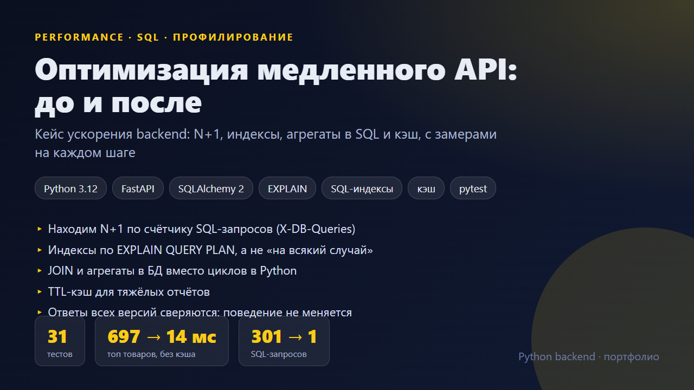
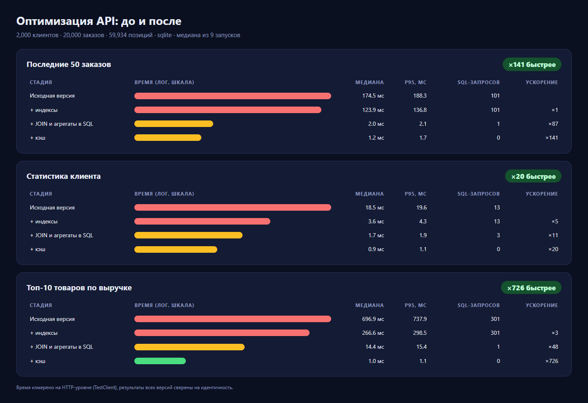
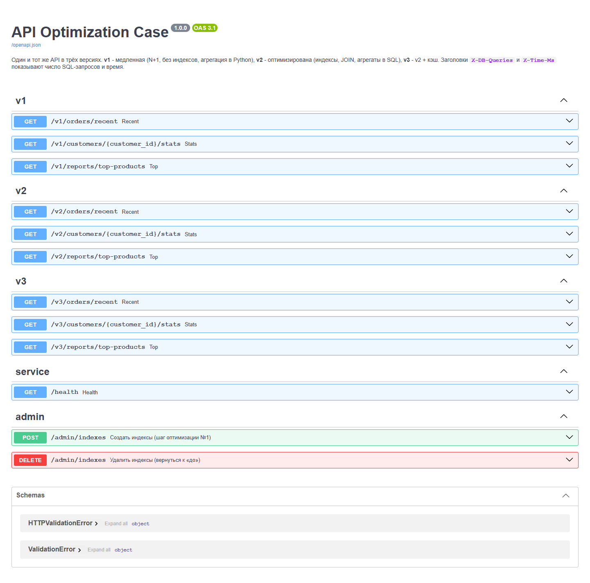
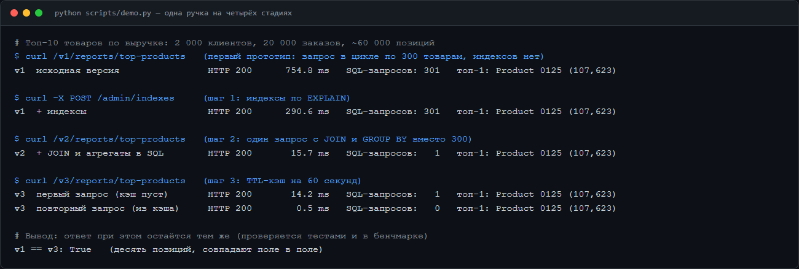
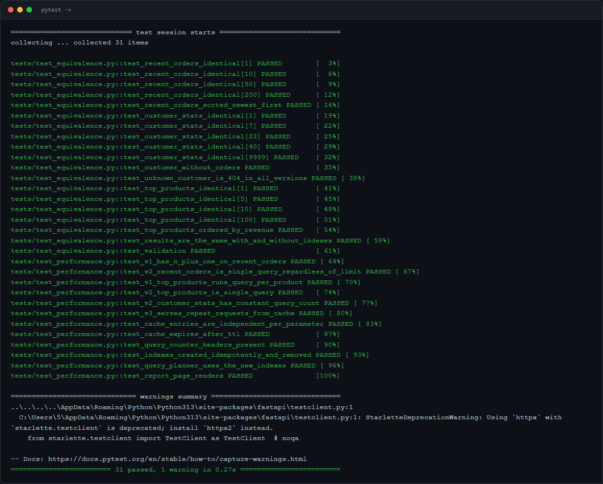

# Оптимизация медленного API: до и после

Учебно-демонстрационный кейс: как найти причину медленного backend и ускорить его в десятки раз, не меняя поведение. Один и тот же API реализован в трёх версиях, а между ними лежит пошаговый разбор.



**Данные:** 2 000 клиентов, 20 000 заказов, 59 934 позиции (SQLite, данные детерминированные: `python -m app.seed`).

## Результаты (медиана из 9 запусков)

| Эндпоинт | Исходная версия | + индексы | + JOIN и агрегаты в SQL | + кэш |
|---|---|---|---|---|
| Последние 50 заказов | 174 мс, 101 запрос | 124 мс, 101 запрос | **2,0 мс, 1 запрос** (×87) | 1,2 мс, 0 запросов |
| Статистика клиента | 18,5 мс, 13 запросов | 3,6 мс, 13 запросов | **1,7 мс, 3 запроса** (×11) | 0,9 мс, 0 запросов |
| Топ-10 товаров по выручке | 697 мс, 301 запрос | 267 мс, 301 запрос | **14,4 мс, 1 запрос** (×48) | 1,0 мс, 0 запросов |

Колонка «кэш» показывает попадания в кэш, то есть повторный запрос. Честное ускорение самой работы с БД показывает колонка «JOIN и агрегаты».



## Что и почему тормозило

| Симптом | Диагностика | Исправление |
|---|---|---|
| 101 запрос на одну ручку | Счётчик `X-DB-Queries` показал рост запросов вместе с `limit`: классический **N+1** (lazy load позиций и клиента на каждый заказ) | Один запрос: сначала `LIMIT` по индексу, затем `JOIN` и агрегаты только для нужных заказов |
| Топ товаров: 301 запрос | Запрос в цикле по каждому из 300 товаров, и каждый делал полный скан `order_items` | Один `GROUP BY` с индексом по `product_id` |
| Полные сканы таблиц | `EXPLAIN QUERY PLAN` показал `SCAN orders` | Четыре индекса под конкретные запросы (`app/indexes.py`) |
| Сортировка и срез в Python | Загружалась вся таблица заказов в память | `ORDER BY ... LIMIT` на стороне БД |
| Дорогой отчёт, который редко меняется | Один и тот же результат считался на каждый запрос | TTL-кэш (в продакшене Redis) |

Важное наблюдение: **индексы одни не спасают**. «Последние заказы» после добавления индексов ускорились только с 174 до 124 мс, потому что запросов по-прежнему 101. Основной выигрыш дала переписанная выборка.

## Как не сломать поведение

- Тесты проверяют, что все три версии возвращают **идентичные** ответы (разные `limit`, клиент без заказов, несуществующий клиент, с индексами и без).
- Тесты считают SQL-запросы, а не миллисекунды. Они стабильны на любой машине и ловят возврат N+1 (`v2` обязан делать 1 запрос при любом `limit`).
- Бенчмарк (`python -m app.bench`) падает, если ответы разных версий не совпали.

## Запуск

```bash
docker compose up --build        # PostgreSQL; /docs, /report
```

```bash
pip install -r requirements.txt
uvicorn app.main:app --reload    # при первом старте база заполняется сама
python -m app.bench              # пересчитать бенчмарк и docs/benchmark.json
python scripts/demo.py
pytest
```

В Swagger видны три группы ручек `v1`, `v2`, `v3`. Ответы содержат заголовки `X-DB-Queries` и `X-Time-Ms`. Индексы можно включать и выключать (`POST` и `DELETE /admin/indexes`), чтобы повторить кейс самостоятельно.

## Скриншоты

| Swagger | Демо-сценарий | Тесты |
|---|---|---|
|  |  |  |
